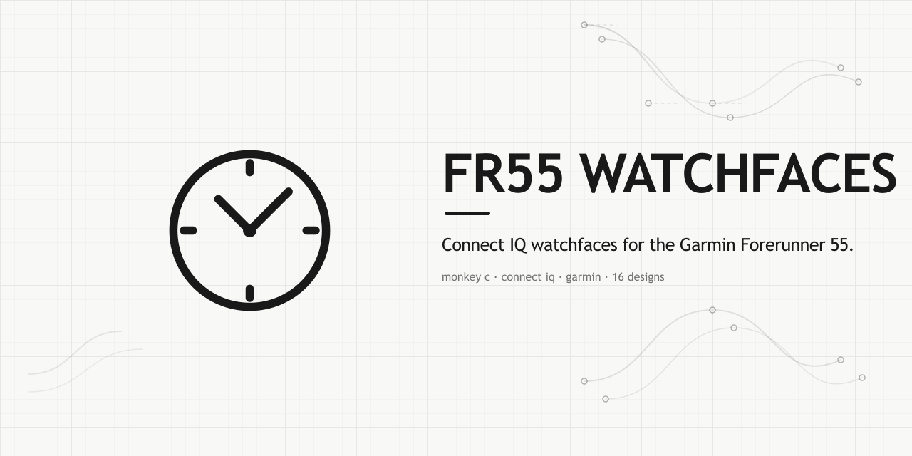

# fr55

[](https://github.com/hieudoanm/fr55/actions/workflows/ci.yaml?branch=master) [](LICENSE)

Topics: `garmin`, `connect-iq`, `monkey-c`, `watchface`



**Live demo:** <https://hieudoanm.github.io/fr55/>

Connect IQ watchfaces for the **Garmin Forerunner 55** (`fr55`, 240×240 MIP), written in Monkey C.

**Keywords:** `Garmin`, `Forerunner 55`, `FR55`, `Connect IQ`, `Monkey C`, `Watchfaces`.

## What's in this repo

- **[`apps/`](apps/)** — 16 buildable Connect IQ watchface apps. Each app has its own `manifest.xml`, `monkey.jungle`, `resources/`, `App.mc`, and `View.mc` so it can be built/run independently — see [`apps/README.md`](apps/README.md) for the full list.
- **[`packages/landing/`](packages/landing/)** — static landing page and documentation site deployed to GitHub Pages.
- **[`assets/`](assets/)** — design previews (`assets/design/svg|png`, 16 watchface concepts) and branding (`assets/branding/`).
- **[`.github/workflows/ci.yaml`](.github/workflows/ci.yaml)** — builds all watchface apps into `.prg` files, publishes them to a rolling `latest` GitHub release, and deploys the landing page to GitHub Pages on `master`.
- **[`ci/devices/`](ci/devices/)** — vendored Connect IQ `fr55` device files for CI builds.

Monkey C editor tooling (VS Code/Zed extensions, `monkey` CLI) lives in the companion repo: <https://github.com/hieudoanm/monkey>.

## Repository layout

```text
.
├── .github/workflows/ci.yaml   # build landing + deploy to GitHub Pages
├── apps/                       # 16 buildable Connect IQ watchface apps
├── assets/                     # design previews, logos, OG images, svg-to-png.sh
└── packages/
    └── landing/                # GitHub Pages landing page + docs
```

## Build and preview an app

Each app is buildable from its own directory with the Connect IQ SDK.

```bash
cd apps/hands
make build                      # builds bin/hands.prg for fr55
make run                        # builds, starts simulator, launches with monkeydo
```

The app `Makefile`s use configurable variables:

```bash
make build DEVICE=fr55 \
  SDK="$HOME/Library/Application Support/Garmin/ConnectIQ/Sdks/<sdk>" \
  DEVELOPER_KEY="$HOME/.config/garmin/developer_key"
```

Direct SDK commands also work:

```bash
monkeyc -f apps/hands/monkey.jungle -d fr55 -o apps/hands/bin/hands.prg -y /path/to/developer_key -w
monkeydo apps/hands/bin/hands.prg fr55
```

## Watchface designs

`assets/design/svg/` holds 16 watchface design previews (240×240 circular MIP
style); `assets/design/png/` holds the rendered PNGs. The landing gallery at
`/gallery` showcases all of them, and `packages/landing/public/watchfaces/`
vendors the SVGs for the site.

## CI and pages

`.github/workflows/ci.yaml` runs for changes under `apps/**`, `assets/**`, `packages/landing/**`, `ci/**`, and on workflow dispatch. On pushes to `master`, it:

- builds every app in `apps/` into a signed `fr55-*.prg` with the Connect IQ SDK and publishes them to the rolling `latest` GitHub release (notes: [`RELEASE.md`](RELEASE.md)) — CI generates a throwaway signing key, so no secrets are needed
- builds the landing page and deploys it to GitHub Pages at <https://hieudoanm.github.io/fr55/>

## Device notes

- Primary target: **Garmin Forerunner 55** (`fr55`), 240×240, API level target depends on each app manifest.
- Watchface drawing is generally resolution-independent (`dc.getWidth()` / `dc.getHeight()`), but manifests/products should be checked before targeting other devices.
- Install a built PRG by copying it to `GARMIN/APPS/` on the watch (USB mass storage) or use Garmin tools/simulator workflows.

## License

This project is licensed under the [MIT License](LICENSE).
