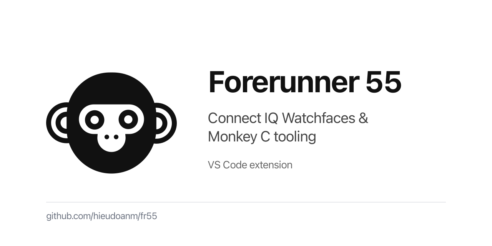

# fr55

[](https://github.com/hieudoanm/fr55/actions/workflows/ci.yaml?branch=master)  [](LICENSE)

Topics: `garmin`, `connect-iq`, `monkey-c`, `watchface`, `vscode-extension`


<p align="center">
  
</p>

**Live demo:** <https://hieudoanm.github.io/fr55/>

Connect IQ watchfaces and tooling for the **Garmin Forerunner 55** (`fr55`, 240×240 MIP).

**Keywords:** `Garmin`, `Forerunner 55`, `FR55`, `Connect IQ`, `Monkey C`, `Watchfaces`, `VS Code Extension`, `VSIX`.

## What’s in this repo

- **[`apps/`](apps/)** — buildable Connect IQ watchface apps. Each app has its own `manifest.xml`, `monkey.jungle`, `resources/`, `*View.mc`, and `*App.mc` so it can be built/run independently.
  - `hands/` — analog hour/minute hands.
  - `minimalism/` — hour/minute dots on a ring with centered heart rate/time.
  - `maximalism/` — 12-hour dot ring, minute marker, battery + heart rate.
  - `timezones/` — stacked London, local/Saigon, and Melbourne times.
- **[`packages/extensions/vscode/`](packages/extensions/vscode/)** — Monkey C/Jungle VS Code extension with syntax highlighting, document formatting, a dark theme, file icons, and a Connect IQ SDK/simulator runtime preview command.
- **[`packages/extensions/zed/`](packages/extensions/zed/)** — Monkey C/Jungle Zed extension with Tree-sitter highlighting, an external formatter, a dark theme, file icons, and Connect IQ runtime-preview tasks.
- **[`packages/landing/`](packages/landing/)** — static landing/download page deployed to GitHub Pages.
- **[`packages/README.md`](packages/README.md)** — overview of the editor extensions.
- **[`assets/`](assets/)** — shared assets: design previews (`assets/design/svg|png`) and branding (`assets/branding/svg|png`: logo, Open Graph image).
- **[`scripts/`](scripts/)** — repo scripts, including Monkey C format/lint helpers (`format.sh`, `lint.sh`, `monkeyc-tools.js`).
- **[`.github/workflows/ci.yaml`](.github/workflows/ci.yaml)** — packages the VS Code extension and publishes a rolling `latest` GitHub release with the VSIX.

## Repository layout

```text
.
├── .github/workflows/ci.yaml   # package VS Code extension + publish latest VSIX
├── apps/                       # buildable Connect IQ watchface apps
│   ├── hands/
│   ├── maximalism/
│   ├── minimalism/
│   └── timezones/
├── assets/                     # design previews, logos, OG images, svg-to-png.sh
├── packages/
│   ├── README.md               # editor extensions overview
│   ├── extensions/
│   │   ├── vscode/             # Monkey C/Jungle VS Code extension
│   │   └── zed/                # Monkey C/Jungle Zed extension
│   └── landing/                # GitHub Pages landing page
└── scripts/                    # Monkey C format/lint scripts
```

## Build and preview an app

Each app is buildable from its own directory with the Connect IQ SDK.

```bash
cd apps/hands
make build                      # builds bin/hands.prg for fr55
make run                        # builds, starts simulator, launches with monkeydo
```

The app `Makefile`s use configurable variables:

```bash
make build DEVICE=fr55 \
  SDK="$HOME/Library/Application Support/Garmin/ConnectIQ/Sdks/<sdk>" \
  DEVELOPER_KEY="$HOME/.config/garmin/developer_key"
```

Direct SDK commands also work:

```bash
monkeyc -f apps/hands/monkey.jungle -d fr55 -o apps/hands/bin/hands.prg -y /path/to/developer_key -w
monkeydo apps/hands/bin/hands.prg fr55
```

## VS Code extension

[`packages/extensions/vscode`](packages/extensions/vscode) provides editor support for `.mc` and `.jungle` files:

- Monkey C/Jungle syntax highlighting and language configuration.
- Built-in document formatting (`Format Document` / `Monkey C: Format Document`).
- Dark theme and file icons.
- **Monkey C: Runtime Preview (Simulator)** — builds the nearest Connect IQ package (`monkey.jungle` + `manifest.xml`), starts the simulator, and runs the PRG with `monkeydo`. Configure `monkeyC.sdkPath`, `monkeyC.developerKeyPath`, and `monkeyC.previewDevice` as needed.

Packaging:

```bash
cd packages/extensions/vscode
pnpm install --frozen-lockfile
pnpm exec vsce package --no-dependencies --out monkey-c.vsix
```

## Zed extension

[`packages/extensions/zed`](packages/extensions/zed) brings the same editor surface to Zed using
Tree-sitter:

- Monkey C/Jungle highlighting, brackets, indentation, folds, outline, and text objects.
- External formatter (`monkey-c-format`) for both languages.
- Dark theme and file icon theme.
- **Monkey C: Runtime Preview** and **Monkey C: Build PRG** tasks using the Connect IQ SDK/simulator.

```bash
cd packages/extensions/zed
./scripts/install.sh   # put monkey-c-format / monkey-c-preview on PATH
make test              # formatter tests + Jungle grammar tests
```

See [`packages/extensions/zed/README.md`](packages/extensions/zed/README.md) for Zed formatter
settings, task usage, and the vendored Jungle grammar requirement.

## Monkey C scripts

```bash
./scripts/format.sh   # format all *.mc files
./scripts/lint.sh     # check trailing whitespace/tabs/format drift
```

## CI and releases

`.github/workflows/ci.yaml` runs for changes under `apps/**`, `scripts/**`, `packages/extensions/vscode/**`, `packages/extensions/zed/**`, `packages/landing/**`, and on workflow dispatch. On pushes to `master`, it updates the rolling GitHub release tagged `latest`:

- asset: `monkey-c.vsix`
- release notes: [`packages/extensions/vscode/README.md`](packages/extensions/vscode/README.md)

## Device notes

- Primary target: **Garmin Forerunner 55** (`fr55`), 240×240, API level target depends on each app manifest.
- Watchface drawing is generally resolution-independent (`dc.getWidth()` / `dc.getHeight()`), but manifests/products should be checked before targeting other devices.
- Install a built PRG by copying it to `GARMIN/APPS/` on the watch (USB mass storage) or use Garmin tools/simulator workflows.

## License

This project is licensed under the [MIT License](LICENSE).
